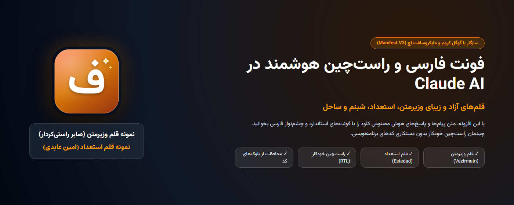
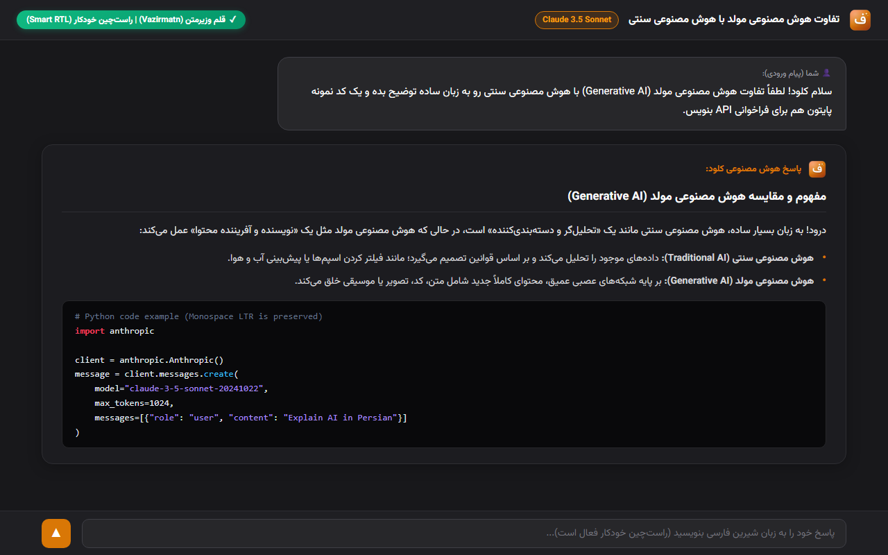
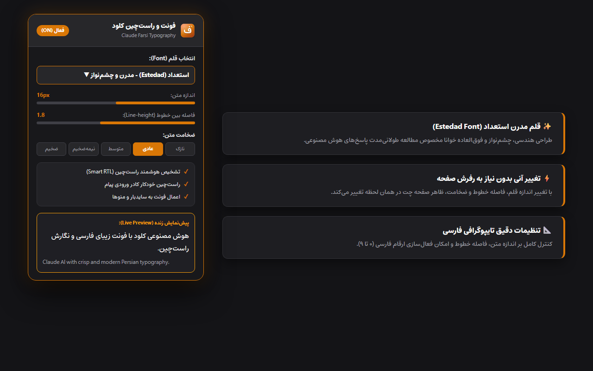

<div align="center">

# فونت فارسی و راست‌چین برای کلود
### Farsi Fonts & RTL for Claude (Vazirmatn & Estedad)


افزونه‌ای مدرن و متن‌باز بر پایه **Manifest V3** جهت بهبود تجربه کاربری و تایپوگرافی زبان فارسی در وب‌سایت [Claude.ai](https://claude.ai) با قلم‌های اصیل و استاندارد **وزیرمتن**، **استعداد**، **شبنم** و **ساحل**.

<br />



</div>

---

## ✨ قابلیت‌های کلیدی (Key Features)

- 🔤 **فونت‌های متن‌باز تعبیه‌شده (Embedded Fonts)**:
  - **وزیرمتن (Vazirmatn)**: اثر ماندگار صابر راستی‌کردار (قلم پیش‌فرض و استاندارد وب فارسی)
  - **استعداد (Estedad)**: اثر امین عابدی (مدرن، خوانا و چشم‌نواز)
  - **شبنم (Shabnam)**: نرم، دلنشین و خوانا
  - **ساحل (Sahel)**: کلاسیک، متوازن و ساده
  - **فونت سفارشی (Custom Font)**: امکان فراخوانی هر فونت نصب‌شده در سیستم‌عامل (ایران‌سنس، دانا، کلمه و...)
- ⚡ **راست‌چین هوشمند و زنده در استریم (Live Streaming RTL)**:
  - تشخیص آنی جهت متن هنگام تایپ استریم پاسخ‌های هوش مصنوعی کلود بدون پرش صفحه.
  - پشتیبانی هم‌زمان از پیام‌های ارسالی کاربر و پاسخ‌های هوش مصنوعی.
- 🎯 **پرهیز از تداخل متن دوزبانه**:
  - بررسی هوشمند تراکم کلمات؛ متون و اصطلاحات انگلیسی به همراه کلمات منفرد فارسی معکوس نمی‌شوند و چپ‌چین می‌مانند.
- ✍️ **راست‌چین خودکار کادر ورودی (Smart Prompt Input)**:
  - با شروع تایپ فارسی، کادر ورودی کلود به‌صورت خودکار راست‌چین شده و با پاک شدن متن به حالت طبیعی برمی‌گردد.
- 🛡️ **حفظ ساختار کدها و فرمول‌های ریاضی (Code & KaTeX Preservation)**:
  - بلوک‌های کد (`pre`, `code`, `.font-mono`) و فرمول‌های LaTeX ریاضی (`KaTeX`) دست‌نخورده، چپ‌چین و با فونت اختصاصی باقی می‌مانند.
- ⚙️ **شخصی‌سازی پیشرفته تایپوگرافی**:
  - تغییر اندازه متن (۱۳ تا ۲۲ پیکسل)، فاصله خطوط (Line-height)، ضخامت قلم (Light تا Bold) و سوییچ ارقام فارسی (۰ تا ۹).
- 🔄 **پیش‌نمایش زنده و رابط دوزبانه (Bilingual & Live Preview)**:
  - پنل تنظیمات با زبان‌های فارسی و انگلیسی و پیش‌نمایش آنی بدون نیاز به رفرش برگه.

---

## 📸 تصاویر محیط کاربری (Screenshots)

<div align="center">
  
  
</div>

---

## 🚀 راهنمای نصب در مرورگرها (Installation Guide)

### روش اول: نصب پوشه بازشده (Developer Mode)

1. مخزن را دانلود یا کلون کنید:
   ```bash
   git clone https://github.com/hojjat-shafiee/claude-chat-farsi.git
   ```
2. مرورگر خود (Chrome، Edge، Brave یا Opera) را باز کنید و وارد آدرس مدیریت افزونه‌ها شوید:
   - کروم: `chrome://extensions`
   - مایکروسافت اج: `edge://extensions`
3. گزینه **Developer mode (حالت توسعه‌دهنده)** را در بالای صفحه فعال کنید.
4. روی دکمه **Load unpacked (بارگیری بازنشده)** کلیک کنید.
5. پوشه پروژه را انتخاب کنید.
6. وارد [claude.ai](https://claude.ai) شوید.

### روش دوم: ساخت پکیج فشرده (Production ZIP)

برای ساخت فایل ZIP آماده بارگذاری در فروشگاه افزونه‌ها:
```bash
python package_extension.py
```
فایل نهایی در مسیر `dist/claude-farsi-fonts-v1.0.0.zip` ایجاد می‌شود.

---

## 📁 ساختار فایل‌های پروژه (Project Structure)

```
claude-chat-farsi/
├── manifest.json              # مانیفست افزونه (Manifest V3)
├── background.js              # Service Worker پیش‌زمینه و مدیریت وضعیت
├── content.js                 # اسکریپت اصلی اعمال فونت و رصدگر استریم DOM
├── css/
│   └── fonts.css              # تعریف @font-face برای وب‌سایت کلود
├── fonts/                     # فایل‌های فونت WOFF2 (Vazirmatn, Estedad, Shabnam, Sahel)
├── icons/                     # آیکون‌های استاندارد در ابعاد ۱۶، ۳۲، ۴۸، ۱۲۸ و ۵۱۲
├── popup/                     # واسط کاربری و اسکریپت منوی پاپ‌آپ
│   ├── popup.html
│   ├── popup.css
│   └── popup.js
├── store-assets/              # بنرها و اسکرین‌شات‌های معرفی افزونه
├── package_extension.py       # اسکریپت بسته‌بندی فایل برای استور
├── PRIVACY_POLICY.md          # سیاست حفظ حریم خصوصی
└── README.md                  # مستندات و راهنمای پروژه
```

---

## 🔒 حریم خصوصی و امنیت (Privacy)

- این افزونه به صورت **۱۰۰٪ محلی (Local-only)** کار می‌کند.
- هیچ‌گونه داده، پیام چت، کوکی یا تلمتری از دستگاه شما ذخیره یا به سرور ثالثی ارسال نمی‌شود.
- تمامی فونت‌ها درون پکیج افزونه تعبیه شده‌اند و هیچ ارتباط شبکه خارجی برقرار نمی‌گردد.

---

## 📜 مجوزها و حقوق مادی و معنوی (Credits & License)

- **Vazirmatn, Shabnam, Sahel**: توسعه‌یافته توسط زنده‌یاد **صابر راستی‌کردار** تحت مجوز آزاد [OFL 1.1](https://scripts.sil.org/OFL).
- **Estedad**: توسعه‌یافته توسط **امین عابدی** تحت مجوز آزاد [OFL 1.1](https://scripts.sil.org/OFL).
- کد منبع افزونه تحت مجوز **[MIT License](LICENSE)** در دسترس عموم است.
